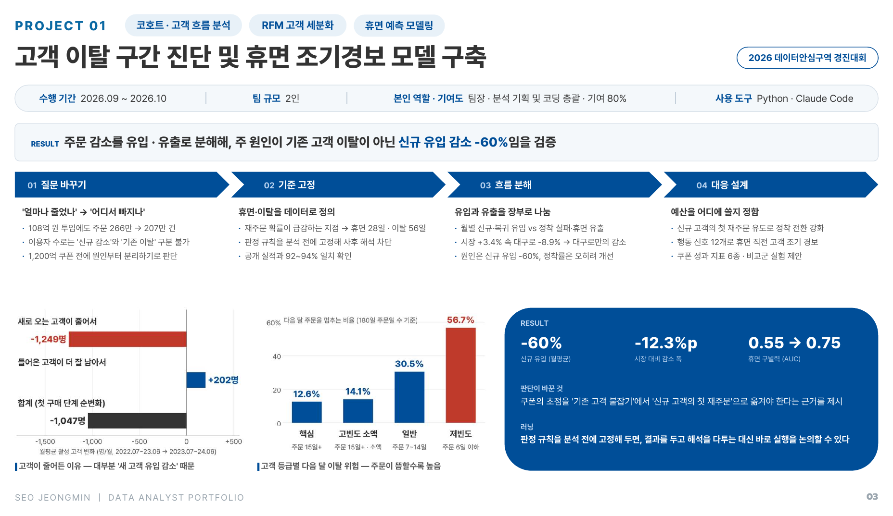
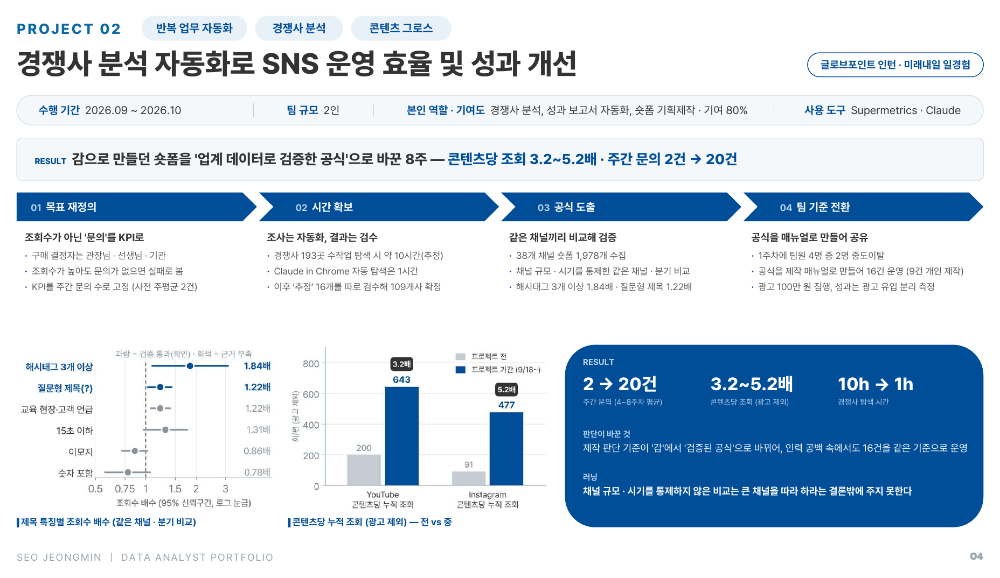
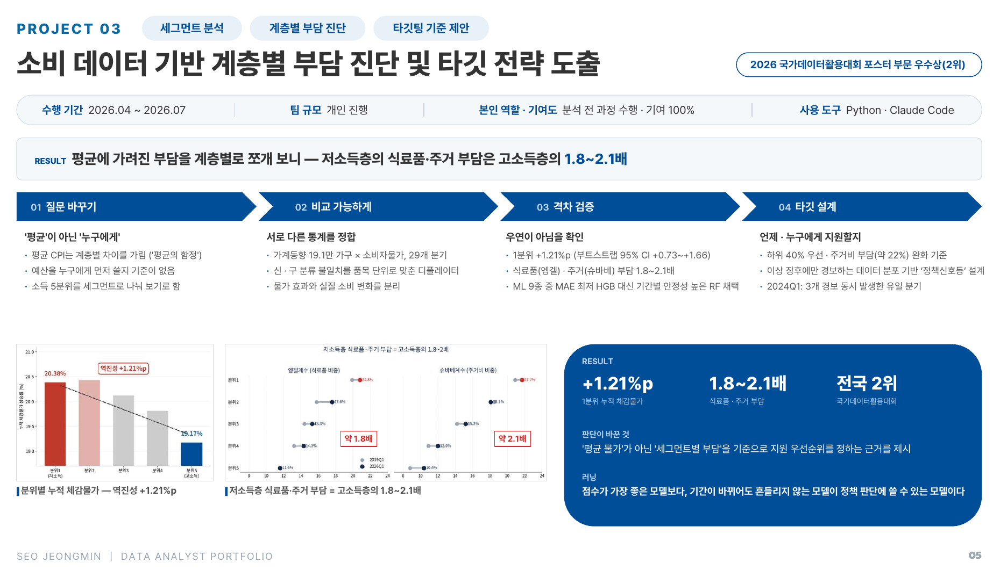
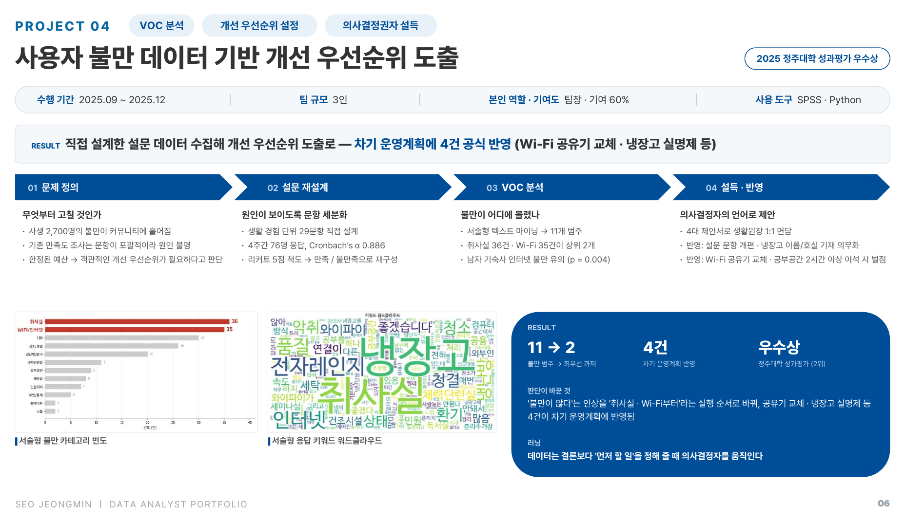

# Portfolio · 서정민 (Data Analyst)

[← Resume로 돌아가기](../)

모든 프로젝트를 **질문 바꾸기 → 기준 고정 → 분해 · 검증 → 대응 설계**의 같은 흐름으로 정리했습니다.
각 프로젝트 페이지에 슬라이드 원본 이미지와 상세 과정을 담았습니다.

---

### P01 · [고객 이탈 구간 진단 및 휴면 조기경보 모델 구축](./고객이탈휴면조기경보) | 2026.09 ~ 2026.10
`코호트 · 고객 흐름 분석` `RFM 고객 세분화` `휴면 예측 모델링` · 2026 데이터안심구역 경진대회 · 2인 팀장 · Python

- 108억 원 투입에도 주문이 266만 → 207만 건으로 줄어든 공공배달앱 '대구로'의 감소를 유입 · 유출로 분해해, 주원인이 기존 고객 이탈이 아닌 **신규 유입 감소(-60%)** 임을 검증
- 재주문 확률 급감 지점으로 휴면 28일 · 이탈 56일을 정의하고, 행동 신호 기반 휴면 조기경보로 **AUC 0.55 → 0.75**

---

### P02 · [경쟁사 분석 자동화로 SNS 운영 효율 및 성과 개선](./SNS경쟁사분석자동화) | 2026.09 ~ 2026.10
`반복 업무 자동화` `경쟁사 분석` `콘텐츠 그로스` · 글로브포인트 인턴(미래내일 일경험) · 기여 80% · Supermetrics, Claude

- KPI를 조회수가 아닌 **주간 문의 수**로 고정하고, 38개 채널 숏폼 1,978개를 같은 채널 · 분기끼리 비교해 제작 공식(해시태그 3개 이상 1.84배 · 질문형 제목 1.22배) 도출
- 콘텐츠당 조회 **3.2~5.2배**, 주간 문의 **2 → 20건**, 경쟁사 탐색 **10h → 1h**

---

### P03 · [소비 데이터 기반 계층별 부담 진단 및 타깃 전략 도출](./소득분위별소비분석) | 2026.04 ~ 2026.07
`세그먼트 분석` `계층별 부담 진단` `타깃팅 기준 제안` · 2026 국가데이터활용대회 포스터 부문 우수상(전국 2위) · 개인 · Python

- 가계동향 19.1만 가구 × 소비자물가(29개 분기)를 품목 단위 디플레이터로 정합해, '평균 물가'가 가린 계층별 부담을 측정
- 1분위 누적 체감물가 **+1.21%p** (부트스트랩 95% CI +0.73~+1.66), 저소득층 식료품 · 주거 부담 = 고소득층의 **1.8~2.1배**

---

### P04 · [사용자 불만 데이터 기반 개선 우선순위 도출](./기숙사문제개선) | 2025.09 ~ 2025.12
`VOC 분석` `개선 우선순위 설정` `의사결정권자 설득` · 2025 정주대학 성과평가 우수상 · 3인 팀장 · SPSS, Python

- 29문항 설문(76명, Cronbach's α 0.886)과 서술형 텍스트 마이닝으로 11개 불만 범주 중 취사실 · Wi-Fi를 최우선 과제로 압축
- 4대 제안서로 생활원장 1:1 면담 → 차기 운영계획에 **4건 반영** (Wi-Fi 공유기 교체 · 냉장고 실명제 등)

---

## 기타 프로젝트

**[사망원인통계 기반 자살 예방 맞춤형 금융교육 정책 제언](./자살예방정책제언)** | 2024.09 ~ 2024.12 · 2024 정주대학 성과평가 우수상 · 팀장 · SPSS
- 5개년(2018~2022) 사망원인통계 MDIS 데이터와 경찰청 변사자통계를 교차 분석해, 연령대 세그먼트별 맞춤형 금융교육 정책을 제언
