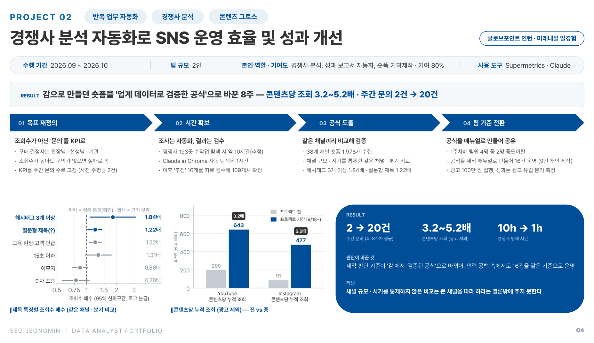

# P02 · 경쟁사 분석 자동화로 SNS 운영 효율 및 성과 개선

[← Portfolio](../) · [Resume](../../)

`반복 업무 자동화` `경쟁사 분석` `콘텐츠 그로스` · **글로브포인트 인턴 · 미래내일 일경험 프로젝트형(8주)**

| 수행 기간 | 팀 규모 | 역할 · 기여도 | 사용 도구 |
|:---:|:---:|:---:|:---:|
| 2026.09 ~ 2026.10 | 2인 | 경쟁사 분석, 성과 보고서 자동화, 숏폼 기획 · 제작 · 기여 80% | Supermetrics · Claude (Code · Skill · in Chrome) |

> **RESULT** 감으로 만들던 숏폼을 **'업계 데이터로 검증한 공식'** 으로 바꾼 8주 — 콘텐츠당 조회 **3.2~5.2배** · 주간 문의 **2건 → 20건**

| **2 → 20건** | **3.2~5.2배** | **10h → 1h** |
|:---:|:---:|:---:|
| 주간 문의 (4~8주차 평균) | 콘텐츠당 누적 조회 (광고 제외) | 경쟁사 탐색 시간 |

---

## 1. 목표 재정의 — 조회수가 아닌 '문의'를 KPI로

- 에듀테크 제품의 실제 구매 결정자는 관장님 · 선생님 · 기관
- 조회수가 높아도 문의가 없으면 실패로 보고, **KPI를 주간 문의 수로 고정** (프로젝트 전 주평균 2건)

## 2. 시간 확보 — 조사는 자동화, 결과는 검수

- 에듀테크 경쟁사 **193곳**의 유튜브 채널 탐색: 수작업 시 약 10시간(추정) → **Claude in Chrome · API 자동 탐색 1시간**
- 자동 연결 결과 중 '추정' 16개를 따로 검수 → 그중 **10개가 잘못 연결**돼 있어 수정, 최종 **109개사 확정**
- 조사 결과는 HTML 보고서와 엑셀 데이터북으로 정리

## 3. 공식 도출 — 같은 채널끼리 비교해 검증

- 38개 채널의 숏폼 **1,978개** 수집
- 채널 규모 · 시기 효과를 걷어내기 위해 **같은 채널 · 같은 분기 안에서** 제목 특징별 조회수 배수를 비교 (95% 신뢰구간)
- 검증 통과: **해시태그 3개 이상 1.84배 · 질문형 제목 1.22배** / 근거 부족: 15초 이하 · 교육 현장 언급 · 이모지 · 숫자 포함

## 4. 팀 기준 전환 — 공식을 매뉴얼로 만들어 공유

- 1주차에 팀원 4명 중 2명이 중도 이탈 → Claude Skill로 **숏폼 기획 · 제작 매뉴얼**을 만들어 16건을 같은 기준으로 운영 (9건 개인 제작)
- 광고 100만 원 집행분은 **광고 유입을 분리**해 전후 비교에서 제외
- Claude + Supermetrics로 **매일 09시 동기화되는 SNS 채널 성과 진단 보고서**를 만들어 성과 집계를 자동화하고 회사에 인수인계

---

## 결과

| 채널 | 프로젝트 전 | 프로젝트 기간 (9/18~) | 배수 |
|---|:---:|:---:|:---:|
| YouTube 콘텐츠당 누적 조회 (광고 제외) | 200회 | 643회 | **3.2배** |
| Instagram 콘텐츠당 누적 조회 (광고 제외) | 91회 | 477회 | **5.2배** |
| 주간 문의 수 | 주평균 2건 | 20건 (4~8주차 평균) | **10배** |

## 판단이 바꾼 것

제작 판단 기준이 '감'에서 **'검증된 공식'** 으로 바뀌어, 인력 공백 속에서도 16건을 같은 기준으로 운영

## 러닝

> 채널 규모 · 시기를 통제하지 않은 비교는 '큰 채널을 따라 하라'는 결론밖에 주지 못한다.
