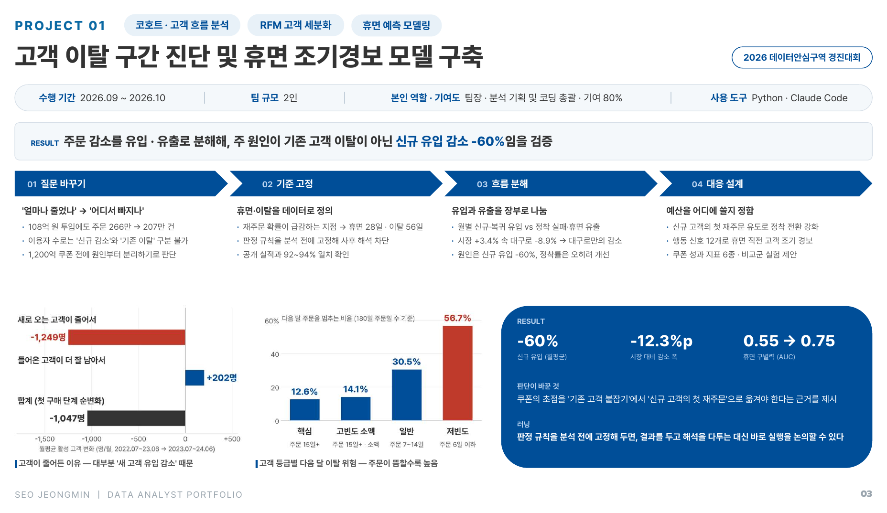

# P01 · 고객 이탈 구간 진단 및 휴면 조기경보 모델 구축

[← Portfolio](../) · [Resume](../../)

`코호트 · 고객 흐름 분석` `RFM 고객 세분화` `휴면 예측 모델링` · **2026 데이터+AI혁신챌린지 데이터안심구역 경진대회**

| 수행 기간 | 팀 규모 | 역할 · 기여도 | 사용 도구 |
|:---:|:---:|:---:|:---:|
| 2026.09 ~ 2026.10 | 2인 | 팀장 · 분석 기획 및 코딩 총괄 · 기여 80% | Python · Claude Code |

> **RESULT** 주문 감소를 유입 · 유출로 분해해, 주원인이 기존 고객 이탈이 아닌 **신규 유입 감소 -60%** 임을 검증

| **-60%** | **-12.3%p** | **0.55 → 0.75** |
|:---:|:---:|:---:|
| 신규 유입 (월평균 7,171 → 2,897명) | 시장 대비 감소 폭 (시장 +3.4% vs 대구로 -8.9%) | 휴면 구별력 (AUC) |

---

## 1. 질문 바꾸기 — '얼마나 줄었나' → '어디서 빠지나'

- 공공배달앱 '대구로'는 108억 원을 투입했음에도 주문이 **266만 → 207만 건**으로 감소
- 이용자 수만으로는 '신규 고객이 덜 들어온 것'과 '기존 고객이 떠난 것'을 구분할 수 없음
- 1,200억 원 규모의 쿠폰 예산을 논의하기 전에, **감소의 원인부터 분리**하기로 판단

## 2. 기준 고정 — 휴면 · 이탈을 데이터로 정의

- 주문 **877만 건**과 신한카드 대구 배달 결제 데이터를 고객 × 일 단위로 결합해 **60.4만 명 × 42개월** 상태 행렬 구축
- 경과일별 재주문(복귀) 확률이 급감하는 지점을 기준으로 **휴면 28일 · 이탈 56일** 정의
- 판정 규칙을 **분석 전에 고정**해 결과를 보고 기준을 바꾸는 사후 해석을 차단
- 재구성한 지표가 공개 실적과 **92~94% 일치**함을 확인

## 3. 흐름 분해 — 유입과 유출을 장부로 나눔

- 월별 **신규 · 복귀 유입 vs 정착 실패 · 휴면 유출**로 고객 흐름을 분해 (항등식 오차 0으로 집계)
- 배달 시장 전체는 +3.4%인데 대구로는 -8.9% → 시장 요인이 아닌 **대구로만의 감소**
- 감소의 주원인은 **신규 유입 감소(-60%)** 이며, 들어온 고객의 정착률은 오히려 개선
  - 월평균 활성 고객 변화(2022.07~23.06 → 2023.07~24.06): 새로 오는 고객 감소 **-1,249명** · 들어온 고객의 잔존 개선 **+202명** → 합계 **-1,047명/월**
- 고객 등급별 다음 달 이탈 위험(180일 주문일 수 기준 등급): 핵심 12.6% · 고빈도 소액 14.1% · 일반 30.5% · 저빈도 56.7% — 주문이 뜸할수록 높음

## 4. 대응 설계 — 예산을 어디에 쓸지 정함

- 쿠폰의 초점을 **신규 고객의 첫 재주문 유도**(정착 전환 강화)로 이동
- 행동 신호 12개 기반 휴면 예측 모형으로, 경과일 단독 기준 대비 **AUC 0.55 → 0.75**
- 신규 유입 × d1 정착률 중심의 **쿠폰 성과 지표 6종**과 무작위 보류군(비교군) 실험 설계 제안

---

## 검증과 한계

- 공개 실적과 92~94% 일치, 미래 기간 검증 후 원인을 '신규 유입 감소'로 확정
- 데이터로 검증할 수 없는 **할인 종료 효과는 '판정 불가'로 명시**
- 원천 데이터와 분석 코드는 이 레포지토리에 포함하지 않았습니다

## 판단이 바꾼 것

쿠폰의 초점을 '기존 고객 붙잡기'에서 **'신규 고객의 첫 재주문'** 으로 옮겨야 한다는 근거를 제시

## 러닝

> 판정 규칙을 분석 전에 고정해 두면, 결과를 두고 해석을 다투는 대신 바로 실행을 논의할 수 있다.
