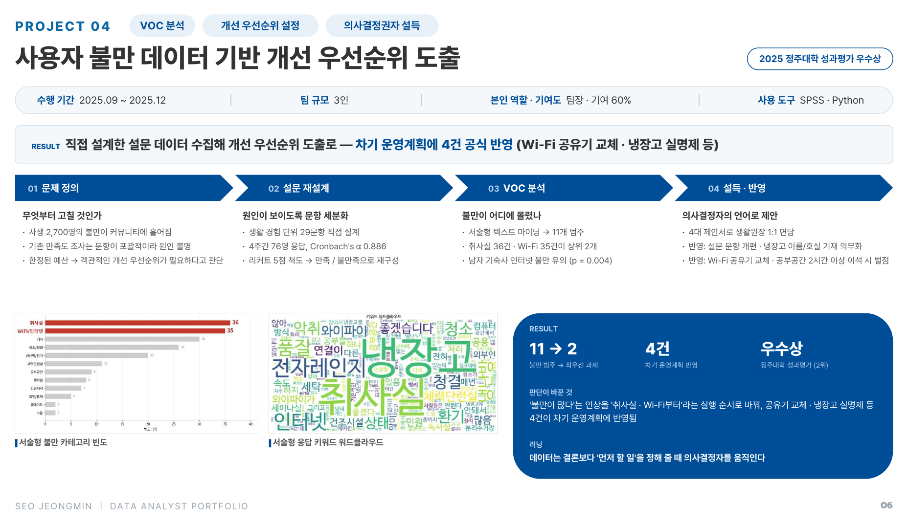

# P04 · 사용자 불만 데이터 기반 개선 우선순위 도출

[← Portfolio](../) · [Resume](../../)

`VOC 분석` `개선 우선순위 설정` `의사결정권자 설득` · **2025 정주대학 성과평가 우수상 (2위)**

| 수행 기간 | 팀 규모 | 역할 · 기여도 | 사용 도구 |
|:---:|:---:|:---:|:---:|
| 2025.09 ~ 2025.12 | 3인 | 팀장 · 기여 60% | SPSS · Python |

> **RESULT** 직접 설계한 설문 데이터로 개선 우선순위를 도출해 — 차기 운영계획에 **4건 반영** (Wi-Fi 공유기 교체 · 냉장고 실명제 등)

| **11 → 2** | **4건** | **우수상** |
|:---:|:---:|:---:|
| 불만 범주 → 최우선 과제 | 차기 운영계획 반영 | 정주대학 성과평가 (2위) |

---

## 1. 문제 정의 — 무엇부터 고칠 것인가

- 2,700명 규모 기숙사의 자치회장으로서, 소음 · 벌레 · 악취 · 인터넷 등 사생 불만이 익명 커뮤니티(에브리타임)에 흩어져 있음을 파악
- 기존 생활원 만족도 조사는 문항이 포괄적이고 학생이 체감하기 어려운 항목(방재, 제초 등)이 섞여 있어 **원인 파악 · 세부 집단 분석이 불가**
- 예산이 한정된 상황 → **객관적인 개선 우선순위**가 필요하다고 판단

## 2. 설문 재설계 — 원인이 보이도록 문항 세분화

- 실제 생활 경험 단위로 세분화한 **29문항 설문**을 직접 설계하고 서술형 문항 추가
- 4주간 **76명** 응답 수집, **Cronbach's α 0.886** 으로 내적 일관성 확인
- 리커트 5점 척도에서 차이가 미미한 중간값(보통)을 통제하고 **만족 / 불만족 2단계로 재구성**

## 3. VOC 분석 — 불만이 어디에 몰렸나

- 성별 · 기숙사(남 2기숙사 vs 여 3기숙사) 독립표본 T검정: 남자 기숙사 **인터넷 불만 유의 (p = 0.004)**
- Python 텍스트 마이닝으로 서술형 응답을 **11개 범주**로 분류 · 빈도 집계
- **취사실(36건) · Wi-Fi/인터넷(35건)** 이 상위 2개 — '냉장고', '전자레인지', '악취'가 핵심 키워드

## 4. 설득 · 반영 — 의사결정자의 언어로 제안

- 분석 결과와 시각화를 담은 **4대 개선 제안서**로 최종 의사결정권자인 생활원장과 1:1 면담
- 차기 운영계획에 반영된 4건

| # | 반영 내용 | 근거 |
|:---:|---|---|
| 1 | 생활원 만족도 조사 설문 문항 개편 | 기존 문항으로는 원인 파악 불가 |
| 2 | 취사실 냉장고 이름 · 호실 기재 의무화 (냉장고 실명제) | 최다 불만 범주: 취사실 36건 |
| 3 | Wi-Fi 공유기 교체 | Wi-Fi 35건 · 남자 기숙사 인터넷 불만 유의 (p = 0.004) |
| 4 | 공부공간 2시간 이상 이석 시 벌점 | 공부공간 장기 점유 방지 제안 |

---

## 판단이 바꾼 것

'불만이 많다'는 인상을 **'취사실 · Wi-Fi부터'라는 실행 순서**로 바꿔, 공유기 교체 · 냉장고 실명제 등 4건이 차기 운영계획에 반영됨

## 러닝

> 데이터는 결론보다 '먼저 할 일'을 정해 줄 때 의사결정자를 움직인다.
