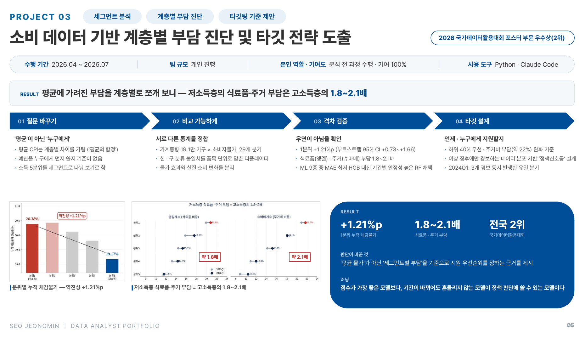

# P03 · 소비 데이터 기반 계층별 부담 진단 및 타깃 전략 도출

[← Portfolio](../) · [Resume](../../)

`세그먼트 분석` `계층별 부담 진단` `타깃팅 기준 제안` · **2026 국가데이터활용대회 포스터 부문 우수상 (전국 2위, 부문 유일 개인 수상)**

| 수행 기간 | 팀 규모 | 역할 · 기여도 | 사용 도구 |
|:---:|:---:|:---:|:---:|
| 2026.04 ~ 2026.07 | 개인 | 분석 전 과정 수행 · 기여 100% | Python · Claude Code |

> **RESULT** 평균에 가려진 부담을 계층별로 쪼개 보니 — 저소득층의 식료품 · 주거 부담은 고소득층의 **1.8~2.1배**

| **+1.21%p** | **1.8~2.1배** | **전국 2위** |
|:---:|:---:|:---:|
| 1분위 누적 체감물가 (vs 5분위) | 저소득층 식료품 · 주거 부담 | 국가데이터활용대회 |

주제: 소득분위 계층별 소비구조 변화와 체감물가 부담의 분배적 분석

---

## 1. 질문 바꾸기 — '평균'이 아닌 '누구에게'

- '소비자물가 상승률', '평균 소비지출' 같은 단일 지표는 같은 경기 충격이 계층마다 다르게 닿는 차이를 가림 (**평균의 함정**)
- 예산을 누구에게 먼저 써야 하는지 판단할 기준이 없음
- 소득 5분위를 세그먼트로 나눠, 분위별 **'체감물가 부담'** 을 측정 대상으로 재정의

## 2. 비교 가능하게 — 서로 다른 통계를 정합

- 2019Q1~2026Q1 **가계동향조사 마이크로데이터(191,096가구, 29개 분기)** × KOSIS 소비자물가지수(CPI)를 5분위 × 29분기 × 12항목 패널로 결합
- 가계동향(신분류)과 CPI(구분류)의 분류 불일치를 **품목 단위로 재집계한 분류 정합 디플레이터**로 해소
- 명목 지출에서 물가 효과를 걷어내 **실질 소비 변화**를 분리

## 3. 격차 검증 — 우연이 아님을 확인

- 라스파이레스 · 파셰 · 피셔 지수를 교차 적용해 분위별 체감물가 산출
- 1분위 누적 체감물가가 5분위보다 **+1.21%p** 높음 — **부트스트랩 95% CI +0.73 ~ +1.66** 로 0을 포함하지 않음
- 엥겔계수(식료품) · 슈바베계수(주거)로 본 저소득층 부담이 고소득층의 **약 1.8배 · 약 2.1배**, 격차가 좁혀지지 않고 고착화
- ML 9종 비교: MAE가 가장 낮은 HGB 대신 **기간별 안정성이 높은 Random Forest 채택**(단순 예측 대비 약 38% 오차 개선), SHAP으로 저소득층은 보건 등 필수재 지출에 민감하고 고소득층은 소득 분위 자체의 영향이 큼을 확인

## 4. 타깃 설계 — 언제 · 누구에게 지원할지

- **하위 40% 우선 지원** · 주거비 부담(약 22%) 완화를 정책 타깃 기준으로 제안
- 체감물가 격차 · 엥겔 격차비 등을 백분위(분포) 기준으로 평가해, 이상 징후에만 경보하는 **'정책 신호등'** 룰 설계
- 2024Q1: 3개 경보가 동시에 발생한 유일한 분기로 포착
- [Business Insight] 계층별 소비 긴축 신호를 선제 포착해, 기업의 소득 세그먼트별 타깃 마케팅 · 수요 예측 지표로 활용 가능

---

## 판단이 바꾼 것

'평균 물가'가 아닌 **'세그먼트별 부담'** 을 기준으로 지원 우선순위를 정하는 근거를 제시

## 러닝

> 점수가 가장 좋은 모델보다, 기간이 바뀌어도 흔들리지 않는 모델이 정책 판단에 쓸 수 있는 모델이다.
